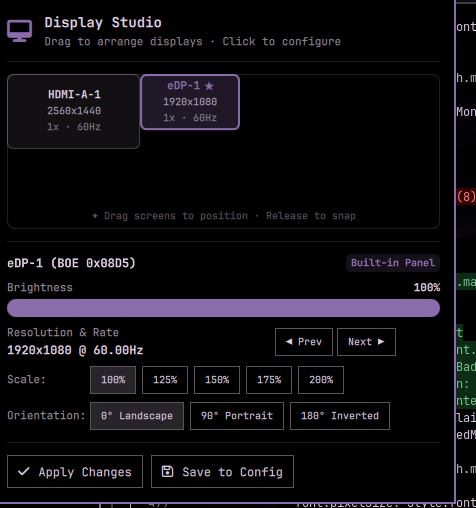

# Display Studio for Omarchy

Visual monitor arrangement, display resolution, refresh rate, scale, orientation, and hardware DDC/CI brightness controls for Omarchy and Hyprland.



## Features

- **Interactive Drag & Snap Canvas:** Direct mouse drag-and-drop monitor positioning with edge snapping and smooth easing
- **Hardware Brightness:** Dedicated brightness control for internal backlights and external monitors via DDC/CI
- **Display Modes:** Supported resolution and refresh rate selection per monitor
- **Scaling & Orientation:** Scale presets (100% - 200%) and orientation (Landscape, Portrait, Inverted)
- **Live & Persistent:** Applies live via Hyprland Lua eval and saves to `~/.config/hypr/monitors.lua`

## Installation

```bash
omarchy plugin add https://github.com/codesdilkhush/omarchy-monitor-arrange --enable
```

## Removal

```bash
omarchy plugin remove codesdilkhush.monitor-arrange
```
